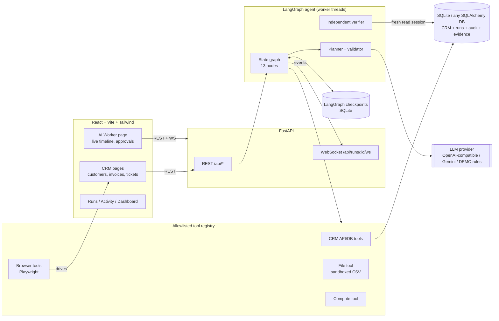
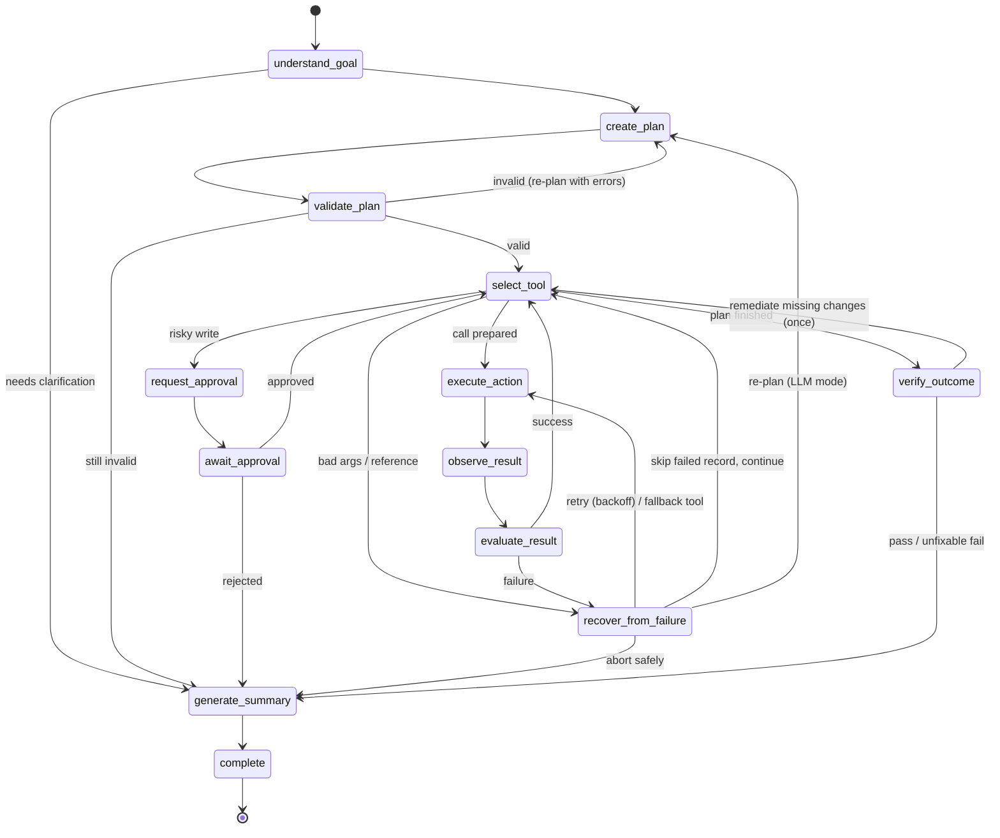

# CentrAlign Worker: an autonomous AI task worker

CentrAlign Worker takes a business goal written in plain English and carries it out in a simulated company CRM. It plans the work, calls allowlisted tools against a real database, watches each result, recovers from failures, asks a human before risky changes, and then checks independently that the outcome actually happened.

```
GOAL → UNDERSTAND → PLAN → EXECUTE → OBSERVE → ADAPT → VERIFY → COMPLETE
```

> "Find all unpaid invoices above ₹50,000, identify the associated customers, update their status to High Priority, and verify that the updates were successful."

For that request the worker:
1. Turns the sentence into a structured goal.
2. Compiles a 3-step plan.
3. Queries invoices and finds 4. A ₹50,000 invoice is correctly left out because the condition is *greater than*.
4. Resolves the 4 linked customers.
5. Pauses for approval with a before/after preview.
6. Hits an injected database timeout, classifies it as transient, backs off and retries.
7. Updates all 4 records.
8. Re-reads ground truth in a fresh session to verify (5/5 checks pass).
9. Reports evidence: record IDs, before/after values, tool call IDs and attempt counts.

---

## Contents
1. [Problem statement and why it matters](#1-problem-statement)
2. [Architecture](#2-architecture)
3. [Agent lifecycle](#3-agent-lifecycle)
4. [Tech stack](#4-tech-stack)
5. [Setup and running](#5-setup)
6. [Running tests](#6-running-tests)
7. [Demo instructions](#7-demo-instructions)
8. [Example tasks](#8-example-tasks)
9. [Failure recovery](#9-failure-recovery)
10. [Human approval](#10-human-approval)
11. [Verification and evidence](#11-verification-and-evidence)
12. [Security considerations](#12-security-considerations)
13. [Design decisions](#13-design-decisions)
14. [Known limitations](#14-known-limitations)
15. [Future improvements](#15-future-improvements)

More detail: [docs/ARCHITECTURE.md](docs/ARCHITECTURE.md).

---

## 1. Problem statement

A useful "AI employee" has to do more than explain what it *would* do. It has to:

- **act** through real systems,
- **notice** when the system does not do what it asked,
- **recover** without looping forever or hiding the failure,
- **know when to stop** and involve a human,
- **prove** the outcome instead of just claiming it.

Most agent demos fall down on the last three. A tool returns `200 OK`, the model writes "Done!", and nobody checks the database. This prototype is deliberately narrow (one CRM, about 14 tools) and puts its effort into execution reliability.

**Why it matters:** in business operations, a confident but wrong "done" costs more than an honest "I couldn't". Every design choice below favours being verifiably right over being fluent.

## 2. Architecture



```
backend/app/
  agent/      graph.py (wiring), state.py (typed state), planner.py, rule_parser.py, executor.py,
              observer.py, recovery.py, approval.py, verifier.py, summary.py, refs.py, llm.py, prompts.py
  tools/      base.py (contracts), tool_registry.py (+ fault injector), crm_tools.py,
              browser_tools.py, file_tools.py, compute_tools.py
  services/   task_service.py (run manager), event_bus.py, audit_service.py, state_reader.py,
              memory_service.py, run_store.py, scenarios.py
  api/        crm.py, tasks.py, runs.py, approvals.py, routes.py
  database/   models.py, session.py, seed.py
  tests/      73 pytest tests
frontend/src/ pages/, components/run/ (timeline, phase stepper, cards, result panel), hooks/, services/
frontend/e2e/ Playwright end-to-end tests
```

## 3. Agent lifecycle

The agent is a real LangGraph `StateGraph` over a typed Pydantic `AgentState`, with conditional edges:



| Phase | What happens | Code |
|---|---|---|
| UNDERSTAND | Natural language → `StructuredGoal` (entities, conditions, grouping, actions), validated against the CRM schema | `planner.interpret_goal`, `rule_parser.py` |
| PLAN | Goal → `Plan` of tool steps that pass data via safe references (`$s1.data[*].customer_id\|unique`). The validator rejects unknown tools, unknown or missing args, forward references and oversize plans | `planner.py`, `refs.py` |
| EXECUTE | One validated call at a time through the registry. Writes are previewed against ground truth first; already-compliant records are skipped | `executor.py` |
| OBSERVE | Expected vs. actual, discrepancy notes (e.g. "5 tickets map to 4 distinct customers"), post-condition check on writes, working-memory update | `observer.py` |
| ADAPT | Classify the failure → bounded retry with exponential backoff, fallback tool, skip the failed branch, re-plan, or abort | `recovery.py` |
| APPROVAL | `interrupt()` pauses the graph. The checkpoint is persisted, so the run survives a server restart | `approval.py` |
| VERIFY | Independent checks (see §11). Missing changes are remediated once, then verified again | `verifier.py` |
| COMPLETE | Summary built from recorded facts (not LLM prose). Evidence, metrics and cross-run memory are persisted | `summary.py` |

## 4. Tech stack

| Layer | Choice |
|---|---|
| Backend | Python 3.11, FastAPI, Pydantic v2, SQLAlchemy 2 |
| Agent | LangGraph (StateGraph, `interrupt`, SQLite checkpointer) |
| LLM | OpenAI-compatible provider (OpenAI, gateways, local servers), **Groq** (verified live with `openai/gpt-oss-120b`), Gemini via its OpenAI-compatible endpoint, deterministic DEMO provider |
| Browser use | Playwright (Chromium, headless) |
| Database | SQLite by default; `DATABASE_URL` takes any SQLAlchemy URL (e.g. PostgreSQL) |
| Frontend | React 19, Vite, TypeScript (strict), Tailwind CSS 4, lucide icons |
| Realtime | WebSockets with history replay, reconnect and a polling fallback |
| Tests | pytest (73), Playwright E2E (7) |
| Packaging | Dockerfile (multi-stage) and docker-compose |

## 5. Setup

Prerequisites: Python 3.11+ and Node 20+.

### Backend
```bash
cd backend
python -m venv .venv
# Windows: .venv\Scripts\activate    macOS/Linux: source .venv/bin/activate
pip install -r requirements-dev.txt
python -m playwright install chromium          # only needed for browser tools / E2E
uvicorn app.main:app --reload --port 8000
```
On first start the database is created and seeded automatically (16 customers, 33 invoices, 16 tickets) under `backend/data/`. To restore the seed data at any time, use **Reset CRM** in the UI or `POST /api/admin/reset`; run history is kept.

### Frontend
```bash
cd frontend
npm install
npm run dev          # http://localhost:5173 (proxies /api and WebSockets to :8000)
```

### Environment variables
Copy `.env.example` to `.env` (repo root or `backend/`). All settings are optional.

| Variable | Default | Meaning |
|---|---|---|
| `LLM_PROVIDER` | `demo` | `demo`, `openai`, `groq` or `gemini`. Without `LLM_API_KEY` the app always runs in DEMO mode |
| `LLM_API_KEY` | – | Read from the environment only, never logged (the audit log scrubs secret-like keys) |
| `LLM_BASE_URL` / `LLM_MODEL` | provider defaults | Any OpenAI-compatible endpoint |
| `APPROVAL_THRESHOLD` | `medium` | Minimum tool risk that needs a human (`none` / `low` / `medium` / `high`) |
| `MAX_RETRIES` / `RETRY_BACKOFF_BASE` | `3` / `0.5` | Retry budget; delay = base × 2^(attempt−1) |
| `DATABASE_URL` | SQLite file | Any SQLAlchemy URL |
| `BROWSER_TOOLS_ENABLED` / `FRONTEND_URL` | `true` / `:5173` | Where the agent's browser finds the CRM UI |

The UI sidebar always shows which engine is active (**DEMO MODE** or the LLM model name).

### Docker
```bash
docker compose up --build      # http://localhost:8000 (UI + API on one origin)
```
The image builds the UI, installs Chromium for browser tools, and serves everything from FastAPI. Data persists in the `centralign-data` volume. *Note: Docker was not available in the environment this was built in, so the image build itself is unverified. The single-origin runtime mode it uses (`STATIC_DIR`, browser tool targeting the same origin) was verified locally. See §14.*

## 6. Running tests
```bash
cd backend && pytest                 # 73 tests, ~5 s, isolated temp database (always DEMO mode)
cd frontend && npx playwright test   # 7 E2E tests; starts its own backend (:8100) + UI (:5174)
cd frontend && npm run build         # strict TypeScript typecheck + production build
```

| Suite | Covers |
|---|---|
| `test_goal_parsing.py` | The 4 required tasks, amount units (k / lakh / crore / Rs.), ranges, grouping, IDs, browser channel, unsupported requests, goal validation |
| `test_planner.py` | Plan shapes, validator rejections (unknown tool, injected args, missing args, forward refs, `$item` misuse, bad values, oversize), reference resolver |
| `test_tools.py` | Tool contracts, strict schemas, the ₹50,000 boundary, activity logging, idempotency, NOT_FOUND, file sandbox, fault injection, approval policy |
| `test_agent.py` | **Full goal → plan → execute → failure → recovery → approval → verification → result**; rejection; lost write caught by verification; bounded retries (backoff 0.5/1/2 s); non-retryable branch stop; compliant-record skip; read-only tasks; "nothing matched" ≠ success; clarification; browser→API fallback; approval surviving a manager restart; LLM mode with an invalid plan that gets re-planned |
| `test_api.py` | CRM endpoints, actor attribution, task → approve → complete over HTTP, WebSocket replay, demo scenarios, file traversal protection |
| `e2e/*.spec.ts` | CRM navigation and filters, human edits, the full demo with approval in the browser, rejection, read-only task, run details and audit log |

## 7. Demo instructions

These steps fit a 3–5 minute video.

1. Open **AI Worker** (http://localhost:5173/worker). Point out the **DEMO MODE / model** badge in the sidebar.
2. Leave the scenario on **"Transient failure → retry"** and click **Run Demo**. (Or type the goal yourself and click **Run Task**.)
3. **UNDERSTAND:** the *Goal understanding* card shows the structured conditions (`invoice.amount > ₹50,000`).
4. **PLAN:** the *Plan* card lists 3 validated steps with tools and risk levels.
5. **EXECUTE / OBSERVE:** the timeline shows real tool calls. Expand one to see its input and output JSON.
6. **APPROVAL:** the run pauses. The orange card shows the 4 records with *current → proposed* values. Click **Approve**.
7. **FAILURE + ADAPT:** the first update fails with `TIMEOUT` (marked *injected fault*). The agent classifies it as retryable, backs off and retries. The phase stepper lights up **ADAPT**.
8. **VERIFY:** 5 independent checks pass.
9. **EVIDENCE:** before → after per record, each with a ✓ verified badge, tool call ID and attempt count. The result tables show the invoices and customers (status before / now).
10. Open **Customers**: the 4 customers are now *High Priority*. Delta Foods (exactly ₹50,000) is untouched.
11. Open **Activity** (CRM history attributed to *CentrAlign Worker* with run links) and the **Agent audit log**. Open **Runs → the run** for metrics.

Other scenarios in the dropdown:
- **Silent lost write → caught by verification:** one update *reports success* but is not persisted. Verification fails (4/5), the agent re-applies the missing change, and verification passes on attempt 2. The evidence table shows the lost write as ✗ *not persisted*.
- **Computer use:** with the UI running, the agent opens the Customers page in headless Chromium, searches, selects the new status and clicks Save, like a human. Screenshots are linked in the evidence. If the UI is unreachable it falls back to the API tool.

## 8. Example tasks

All of these run through the same graph. Only the goal changes.

| # | Task | What the worker does |
|---|---|---|
| 1 | Find unpaid invoices above ₹50,000 and mark their customers as High Priority. | 4 invoices → 4 customers → approval → 4 updates → verify |
| 2 | Find all open support tickets with high priority and show me the affected customers. | 5 tickets → notes that they map to 4 distinct customers → read-only, no approval |
| 3 | Find overdue invoices and identify customers who have more than one overdue invoice. | 10 invoices → `group_records` (≥2) → Epsilon Pharma, Iota Motors, Theta Healthcare |
| 4 | Find customers with open high-priority support tickets and update their status to At Risk. | 4 customers; Iota Motors is already At Risk, so it is skipped as compliant → 3 updates |
| – | overdue invoices under 20k from high risk customers, export to csv | Composes filters and a sandboxed CSV export, and verifies the file |
| – | Mark customer #999 as At Risk | Nothing matches → reports *needs attention*, not a fake success |
| – | Delete all paid invoices | No such capability → asks for clarification and executes nothing |

## 9. Failure recovery

Failures are typed (`TIMEOUT`, `RATE_LIMITED`, `UNAVAILABLE` are retryable; `NOT_FOUND`, `VALIDATION`, `CONFLICT`, … are not). The recovery node chooses, in this order:

1. **Retry** a retryable error with exponential backoff (0.5 s, 1 s, 2 s). At most `MAX_RETRIES=3`.
2. **Fallback tool**, if the tool declares one (browser tool → API tool).
3. **Stop that branch:** mark the record failed, keep processing the others, and report it.
4. **Re-plan** with the error as context (LLM mode, at most once).
5. **Abort safely** with an explanation.

Verification adds one more loop. If records are not in the desired state because of a transient failure or a lost write, a remediation step is appended (covered by the original approval) and verification runs again, once. Faults are injected into the *environment* (the tool registry), not the agent, so the agent has to genuinely detect and handle them.

## 10. Human approval

Every tool has a risk level: **LOW** for reads, compute and internal notes; **MEDIUM** for record updates; **HIGH** for external communication (emails go to a simulated outbox). Steps at or above `APPROVAL_THRESHOLD` pause the graph with LangGraph `interrupt()`.

Before asking, the agent previews the change against ground truth. The approver sees each record's current and proposed value, and records that are already compliant are excluded. **Approve** resumes from the checkpoint. **Reject** stops safely: nothing is written and the summary says so. Approvals are stored with decider, comment and timestamps, and because the checkpointer is SQLite-backed, a pending approval survives a server restart (tested).

## 11. Verification and evidence

Verification never trusts tool responses:

| Check | How |
|---|---|
| **Record state** | Re-read every targeted record through `StateReader` (a fresh DB session, separate from the tools) and compare with the desired value. *Expected N, observed M.* |
| **Filter conformance** | Every record a search returned must actually satisfy the filters that produced it (e.g. each invoice is `unpaid` and `> 50,000`) |
| **Re-query consistency** | Re-run read queries whose filters this run did not modify and compare the ID sets |
| **Artifacts** | Outbox messages exist; CSV files exist with the expected row count |

Evidence is stored in the `evidence` table: changed records (before/after, verified flag, tool, call ID, attempts, screenshot), source records, and artifacts. The final summary is built from these facts. If nothing matched, or verification failed, the run ends as **needs_attention**, never "completed".

### Guarding against LLM mistakes (found by testing against a real model)

Running the agent against Groq's `openai/gpt-oss-120b` surfaced real failure modes. Each is now caught deterministically:

| Observed LLM behaviour | Safeguard |
|---|---|
| Added actions nobody asked for (CSV exports, activity notes; once mapping "verify the updates" to a note) | **Grounding:** each extracted action must quote words from the request, and the quote must fit the action type. Otherwise it is dropped and the timeline says so |
| Plans with writes outside the goal | **Write alignment:** every write step must correspond to a goal action |
| Plan skipped a goal entity ("show me the affected customers" without fetching customers) | **Entity coverage:** every goal entity must be read or written by some step |
| Plan dropped a filter from the goal | **Condition coverage:** every goal condition must be applied by a step's filters |
| Referenced a field that doesn't exist (`$item.customer_id` on customer records) | Tools publish their **output record fields** to the planner. Reference errors list the available fields, so re-planning has actionable feedback |
| Ambiguous request ("risky" = risk level or status?) read inconsistently between runs | **Ambiguity forces a human:** if understanding reports an ambiguity, write steps require approval even when auto-approve is on, and the approval message shows the ambiguity |

Validator rejections feed back into re-planning. With these checks the four required tasks, a free-form request and the full demo scenario run correctly in LLM mode, and the ambiguous request never writes without a human.

## 12. Security considerations

- **Allowlisted tools only.** The LLM produces JSON data, never code. Plans are validated (tool names, argument names, schemas, references) before anything runs, and arguments are validated again at call time with `extra="forbid"` models.
- **No arbitrary execution.** No eval, shell, SQL or URL tools. References use a tiny grammar (`$step.field[*]`) resolved over plain dicts.
- **Sandboxed side effects.** Emails go to a simulated outbox. CSV exports accept only `[A-Za-z0-9_-]` stems and are path-checked inside `DATA_DIR/reports`. The file-serving endpoint allows only two folders and safe names.
- **Least surprise.** Risky writes need approval. Unsupported verbs (delete, refund, …) lead to a clarification request.
- **Secrets.** API keys come from the environment only. `.env` is git-ignored. The audit log scrubs keys like `api_key`, `token`, `password`.
- **Checkpoint deserialization** is restricted to an explicit allowlist of the app's own state types.

## 13. Design decisions

- **Plan-then-execute with validated references, not free-form ReAct.** A full plan can be validated as a whole before any side effect, shown to the user, and executed deterministically. The LLM chooses tools from the registry catalog. The backend decides whether a call is allowed.
- **DEMO mode is a real planner, not a script.** A small compositional grammar produces the same `StructuredGoal` an LLM would, and a deterministic compiler turns any goal into a plan. Nothing is keyed on specific task strings, which is why the extra example tasks in §8 work too. Every action is a real database operation.
- **One tool call per graph step.** Each call, retry and fallback is a visible, checkpointed transition. This makes the timeline honest and makes recovery logic local.
- **Faults live in the environment.** Fault injection sits in the tool registry, so the demo's failures are indistinguishable from real ones to the agent.
- **Independent verification + remediation.** The *lost write* scenario shows why "the tool said OK" is not proof.
- **Facts-only summaries.** The final report is assembled from recorded results, so it cannot overclaim.
- **Idempotency first.** Before any write, current values are read. Already-compliant records are skipped and the approval count reflects only real changes.
- **Simple infrastructure.** SQLite, threads and an in-process event bus are enough for a local prototype. The seams for PostgreSQL, a job queue and Redis pub/sub are explicit (see ARCHITECTURE.md).

## 14. Known limitations

- **LLM output varies between runs.** The safeguards above stop wrong *writes*, but an LLM can still answer a read-only question with a different (validated, verified) interpretation than you intended. The Goal understanding card shows exactly what was understood. LLM mode was verified live with Groq `openai/gpt-oss-120b`; automated tests use a scripted fake LLM so they are deterministic. If the LLM fails, the app falls back to the rule planner and labels it.
- **Docker image build not verified** (Docker was not installed). The runtime mode it uses was verified locally.
- **The DEMO grammar is finite.** It handles combinations of the supported entities, filters and actions. Anything else gets a clarification request rather than a guess.
- **Single process.** Runs execute on threads and events fan out in-process. Horizontal scaling needs a job queue and a shared pub/sub.
- **Verification-driven remediation runs once.** Re-planning on failure only happens in LLM mode (the rule planner would produce the same plan again).
- The browser tool starts a fresh headless browser per call (about 1–2 s each). Injected demo faults are also recorded in cross-run "tool reliability" memory.
- No authentication or multi-tenant isolation (local prototype).

## 15. Future improvements

- Per-tool idempotency keys and a transactional outbox for writes. A dry-run mode that shows the full diff before approval.
- Policy-as-code for approvals (amount thresholds, per-customer rules, approver roles) and multi-step approval chains.
- LLM-assisted *re-planning on verification failure* and an LLM critic that cross-checks the plan against the goal.
- Learning workflows from the activity log (cross-run memory of successful plans as reusable "SOPs").
- A Postgres + Redis + worker-queue deployment, OpenTelemetry traces per tool call, and auth/RBAC.
- More environments behind the same tool contract (email, ticketing, accounting) to show generalization beyond one CRM.
